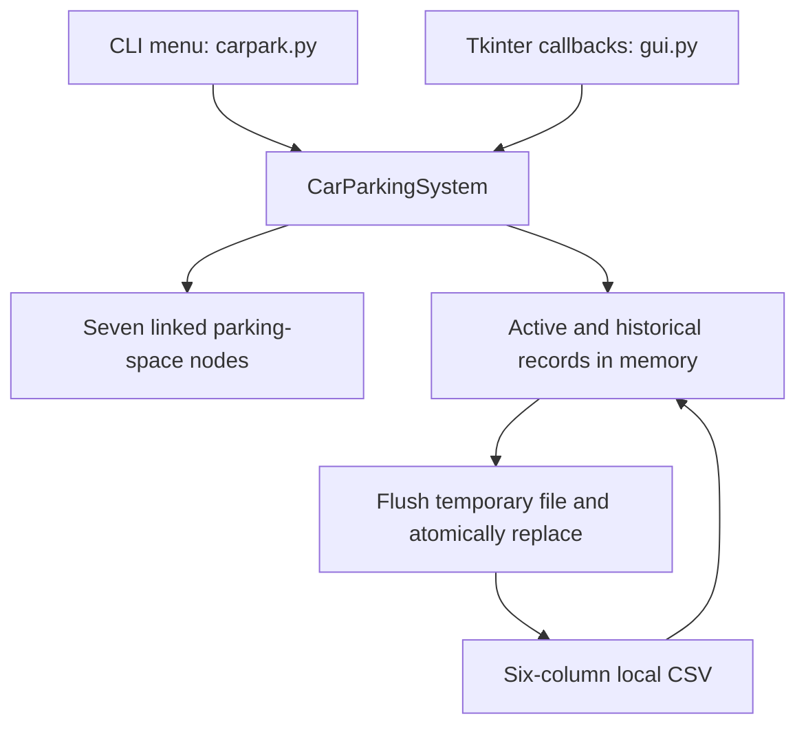

# Car parking application: architecture and operation

Current maintenance review: **14 November 2026**, against repository base `3a7f5572e21d92541be6ded72935807d2af7fb82`. Original recovered coursework is preserved in [coursework/original](../coursework/original/). This document describes the maintained root-level application; it does not describe a deployed service.

## Components and data flow

`getAvailableSpaces()` enumerates the linked-list space IDs; despite its name, it does not subtract occupancy. `createParkingSpace()` subtracts the IDs of active records and chooses randomly from the remainder. Only rows whose exit time equals `Parking...` reserve a space. A full park returns `None`. Released rows remain as history and no longer reserve a space.

| CSV column, in order | Contract |
| --- | --- |
| Registration Number | Format-checked `AA00AAA` on interactive entry |
| Ticket Number | Random digits/letters combined with the registration |
| Parking ID Number | Space ID from 1 through 7 |
| Entry Time | Local timestamp, `%Y-%m-%d %H:%M:%S.%f` |
| Exit Time | Timestamp, or `Parking...` for an active stay |
| Parking Fee | Calculated GBP amount, or `Parking...` while active |

The loader accepts an empty file, a missing file, or the exact header plus six-field records. It accepts UTF-8 with or without a BOM. A mismatched header or record width raises `ValueError` before a write. This is schema validation, not complete semantic validation of every historical field; malformed timestamps or space IDs can still fail when used.

## Decisions and their consequences

| Decision | Reason | Boundary |
| --- | --- | --- |
| Keep the original linked-list and CSV model | Makes the coursework data structures inspectable | Seven spaces; growing history is scanned in memory |
| Derive occupancy from active records | Departed vehicles release capacity without deleting history | No shared-writer locking |
| Atomic replacement after flush/fsync | Failure before replacement preserves existing on-disk bytes | No cross-process transaction or automatic backup |
| Accept explicit `--data-file` in both interfaces | Isolates demonstrations from historical records | The caller creates a writable parent directory |
| Validate the known header instead of skipping any first row | Prevents silently dropping headerless data or misreading another schema | CSV content otherwise remains trusted local project data |

Fees are `round(max(0, duration.total_seconds()) / 3600 * 2, 2)`. Negative elapsed time is clamped at zero. Times are naive local datetimes; daylight-saving and timezone policies are not implemented. Tickets are lookup strings, not authentication credentials or guaranteed unique IDs.

## Failure and recovery

Back up a data file before manually editing it. For a header error, open a copy and compare it with the table above; do not delete the first data row to make loading succeed. For permission or disk errors, preserve the existing file, choose a writable directory and restart. CSV replacement failure leaves the existing file intact, but a failed action can leave in-memory state ahead of disk; close and reopen before retrying. The GUI does not yet wrap every I/O error in a recovery dialog.

Do not run the GUI and CLI against the same file simultaneously. Independent processes load separate in-memory copies and a later save can overwrite another process's work. This is a one-operator local model.

## A defensible next design

For multiple operators, extract entry and exit into shared service methods used by both interfaces. Replace CSV occupancy writes with SQLite transactions and uniqueness constraints for an active space, active registration and ticket. Introduce migrations, UTC timestamps, retryable UI errors and an explicit retention policy. Preserve CSV as an import/export adapter. Validate simultaneous reservations and crash recovery before claiming concurrent operation; measure history size and query time before choosing indexes or a hosted database.

## Maintenance boundary

Earlier November maintenance fixed full-capacity allocation, occupancy after exit, negative fees and atomic writes. This update adds header/BOM validation and explicit file selection. It does not rewrite the recovered assignment or claim that the new code received the historical 99% result. [Verification](VERIFICATION.md) records nine automated regressions; interactive GUI workflows have not been manually evaluated in this update.
